<p align="center">
  
</p>

<h1 align="center">RepertIA</h1>

<p align="center"><b>Analisi forense di copie di dischi e pendrive, estrazioni di smartphone e registri di volo dei droni, con intelligenza artificiale locale e offline.</b></p>

<p align="center">
  <a href="https://github.com/silvexe/RepertIA/releases/latest"></a>
  <a href="LICENSE"></a>
  
  
  <a href="#provato-su-dati-di-riferimento-pubblici"></a>
</p>

🇬🇧 **English version: [README.md](README.md)**

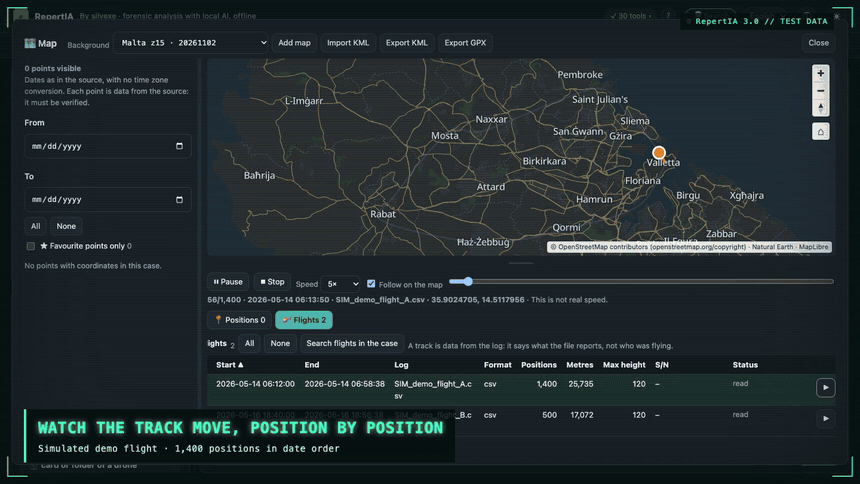

🎬 **Guarda la demo** (dati di prova da un'immagine pubblica di Josh Hickman e un volo simulato, dichiarati nel video). Da scaricare: [italiano](https://github.com/silvexe/RepertIA/releases/download/v3.0.4/RepertIA-demo-3.0.4-it.mp4) · [inglese](https://github.com/silvexe/RepertIA/releases/download/v3.0.4/RepertIA-demo-3.0.4-en.mp4)

https://github.com/user-attachments/assets/ce5dc7b1-5f86-425e-8a4b-82e186ed4d79


📘 **Guida illustrata:** [italiano e inglese, un'unica pagina](https://github.com/silvexe/RepertIA/releases/download/v3.0.4/RepertIA-guida-3.0.4.html)

RepertIA analizza copie forensi (E01, raw/dd, dmg), dalla 2.20 estrazioni del file system completo di iPhone e telefoni
Android, dalla 3.0 registri di volo dei droni e, dalla 3.0.2, sorgenti logiche (archivi zip, tar, 7z e rar, immagini
logiche AD1 di FTK Imager, immagini di CD/DVD ISO e UDF o una cartella) e, dalla 3.0.4, dump della memoria RAM di
computer Windows, da un'unica interfaccia web locale, su Mac Apple Silicon, Windows o Linux (sperimentale).
Usa strumenti forensi riconosciuti (The Sleuth Kit, libewf, plaso, PhotoRec, bulk_extractor, ExifTool, libyal) e ne
raccoglie i risultati in un caso consultabile con filtri, timeline e anteprime. Un modello linguistico che gira sul
computer dell'analista (facoltativo) risponde a domande in italiano o in inglese citando file, offset e inode.
**Nessun dato lascia il computer**: niente cloud, account o telemetria; l'interfaccia ascolta solo su 127.0.0.1.

**RepertIA funziona completamente SENZA intelligenza artificiale.** Il modello IA locale **non è incluso** nei
pacchetti: è una scelta facoltativa dell'utente (LM Studio, llama-server od Ollama), che si può usare o meno. Senza
modello tutte le analisi, le ricerche e i report funzionano lo stesso.

## Provato su dati di riferimento pubblici

RepertIA è stato messo alla prova su immagini pubbliche preparate da altri, con le risposte attese scritte da chi le ha
create. Le prove le abbiamo fatte noi, e pubblichiamo dati, metodo e [script](tools/prove/) perché chiunque possa rifarle.

| Prova | Dati di riferimento | Risultato |
|---|---|---|
| **Recupero dei file cancellati** | 90 immagini NIST CFTT «Deleted File Recovery» | File completi e giusti: **primo o pari al primo** rispetto ai rapporti pubblicati, su FAT, exFAT, NTFS ed ext. Su exFAT **tutti** (273/273 e 376/376) → [dettagli](docs/prove/nist-dfr-carving.it.md) |
| **Carving di immagini** | 26 immagini NIST CFTT «Graphic File Carving» (2014 e 2023) | File interi, anche non allineati ai settori: **pari al miglior risultato pubblicato**, zero falsi positivi. File frammentati del 2014: **sotto** il migliore → [dettagli](docs/prove/nist-dfr-carving.it.md) |
| **Caso completo** | NIST CFReDS «Data Leakage» (PC, chiavetta, CD-R), 60 domande con le risposte ufficiali | **53 domande verificate sulle immagini: risposte uguali a quelle NIST**, salvo poche differenze, spiegate, tra i dati delle immagini e le risposte NIST (e un messaggio di posta nello spazio non usato dell'OST, che RepertIA non legge); le altre 7 sono di ragionamento dell'analista. Sette difetti trovati e corretti → [dettagli](docs/prove/nist-data-leakage.it.md) |
| **Smartphone** | Android 14 e iOS 17 di Joshua Hickman, con il diario delle azioni | **Tutte le 262 azioni presenti nei dati dei telefoni** ritrovate, con i dati giusti anche dove il diario sbaglia verso, ora o numero (5 casi). Le altre 2 annotate nel diario non sono nel registro del telefono → [dettagli](docs/prove/smartphone-hickman.it.md) |

Non è una certificazione: NIST e Joshua Hickman non hanno provato RepertIA. Abbiamo usato i loro dati pubblici.

## Schermate

*Schermate reali di RepertIA, realizzate con dati di prova pubblici o costruiti e nomi di fantasia.*

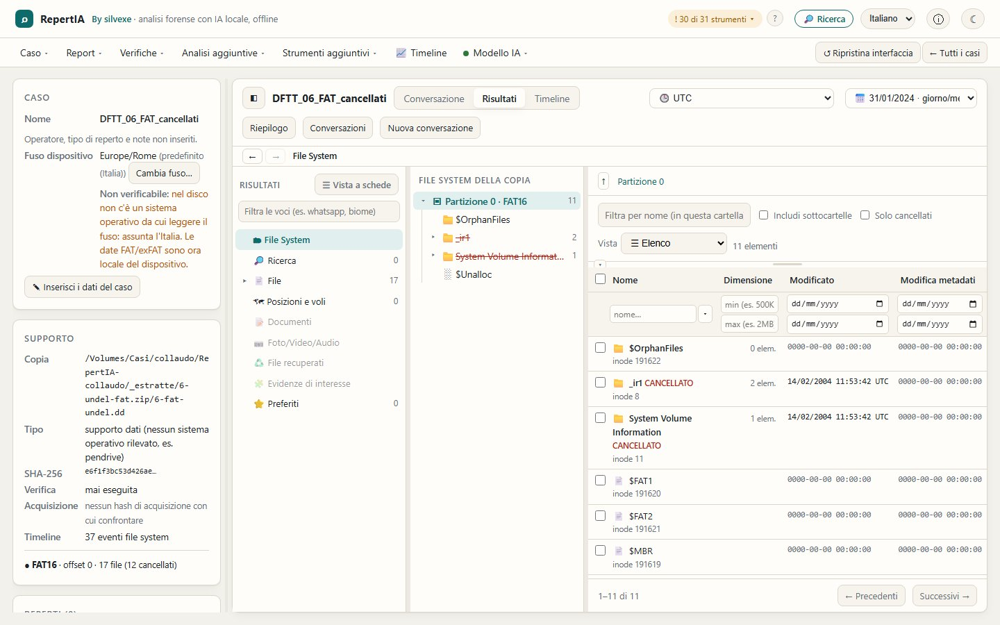

### Che cosa si può caricare

| Memorie di massa | Smartphone |
|---|---|
| 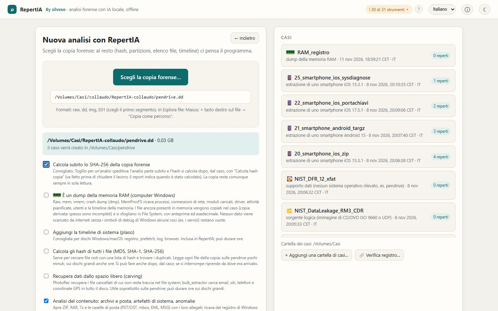 | 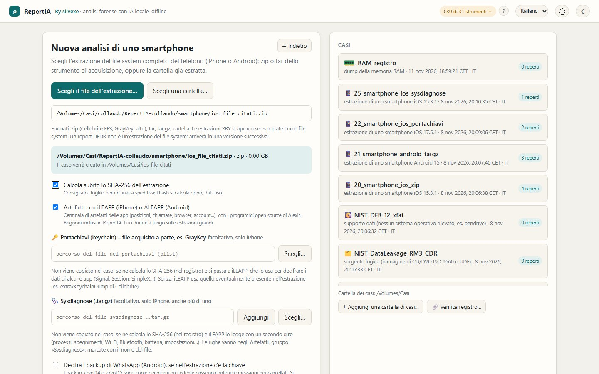 |
| Copie forensi di dischi, SSD, pendrive e schede: E01, raw/dd, img, dmg | Estrazioni del file system completo di iPhone e Android (Cellebrite, GrayKey, altri): zip, tar, tar.gz o cartella. Facoltativi: portachiavi e sysdiagnose di iOS |

Dalla 3.0.2 anche **🗂️ Sorgente logica**: file già raccolti da altri (zip, tar, tar.gz, 7z, rar, immagini logiche AD1 di FTK Imager con gli hash di FTK ricontrollati file per file, immagini di CD/DVD ISO 9660 e UDF, una cartella).

Dalla 3.0.4 anche i **dump della memoria RAM** di computer Windows (raw, mem, vmem, crash dump), dalla stessa pagina delle memorie di massa: processi, connessioni di rete, moduli, driver, attività pianificate, servizi e utenti letti con MemProcFS, più gli artefatti di Windows dal registro ancora in memoria. Con un caso aperto non viene scaricato nulla da internet.

| Scelta del dump | Processi in memoria |
|---|---|
| 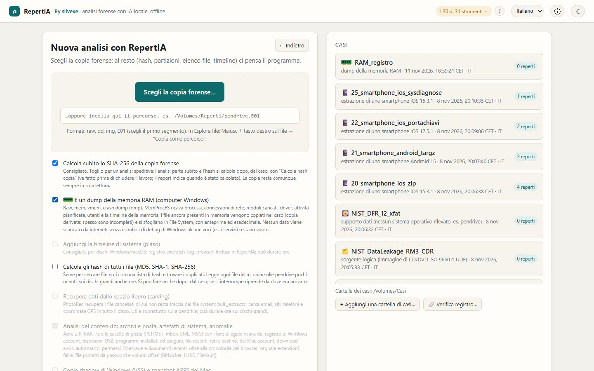 | 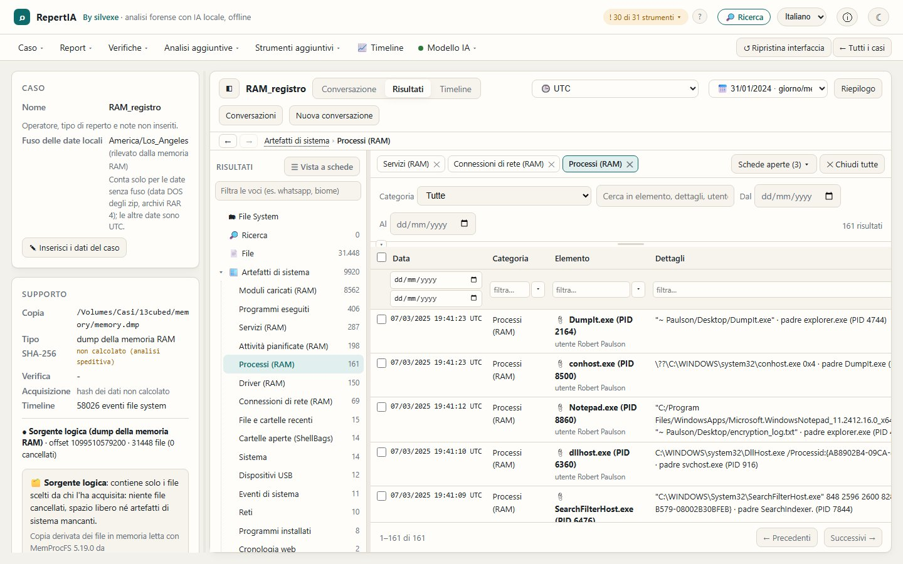 |
| Il dump si indica come una copia forense, con la casella «È un dump della memoria RAM» | Ogni processo con PID, riga di comando, processo padre e utente (dump pubblico di prova) |

<details>
<summary><b>Altre schermate</b></summary>

<br>

**Timeline**: dalla 3.0.4 in una pagina a sé, dal pulsante in alto; grafico dell'attività ed eventi, con filtri per data, evento e fonte.

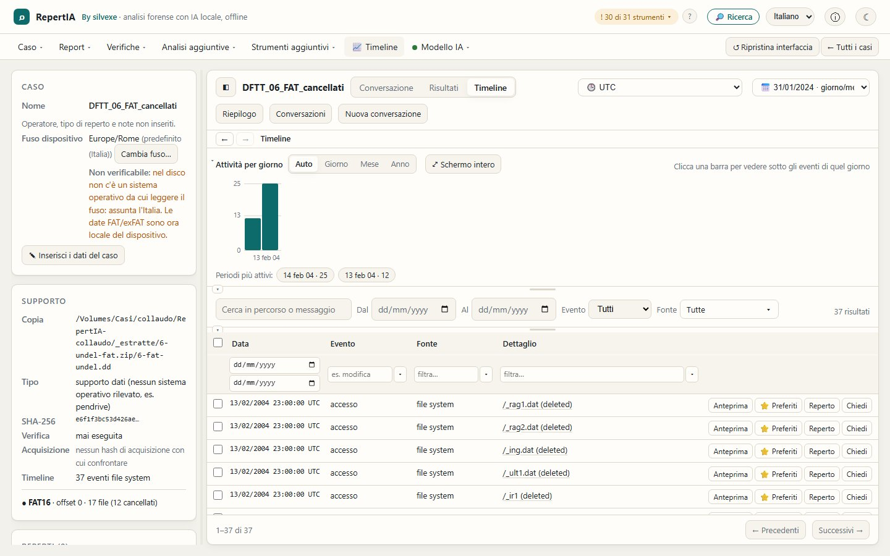

**Ricerca**: parole, espressioni regolari o hash, fino ai byte grezzi della copia.

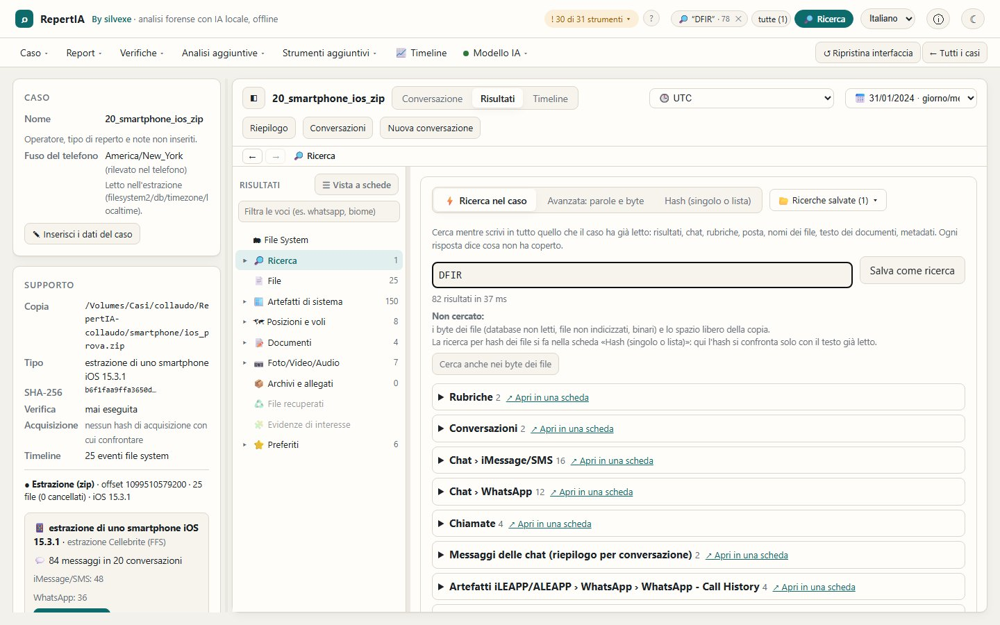

**Chat**: conversazioni con database, tabella e riga di ogni messaggio. Qui iMessage da un'immagine pubblica di prova.

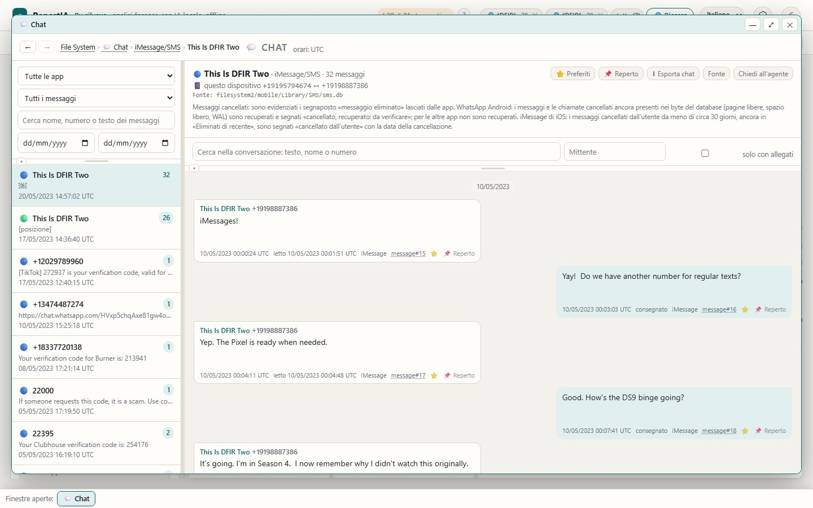

**Sysdiagnose di iOS**: acquisiti a parte e letti con iLEAPP.

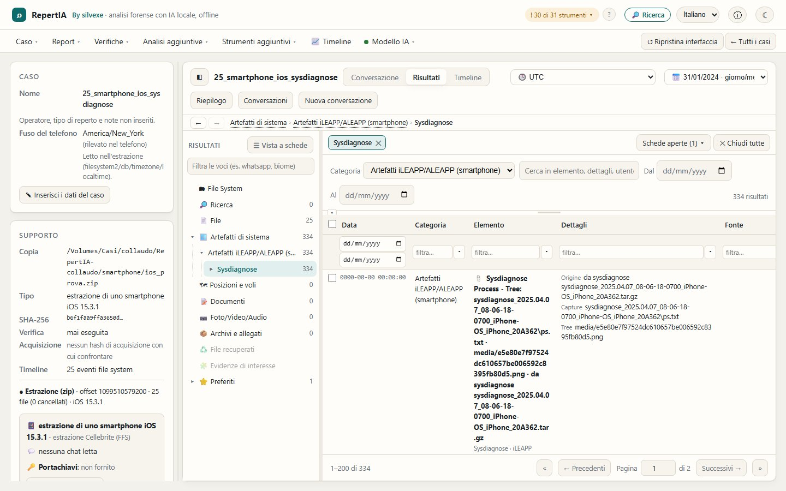

**Portachiavi**: password, chiavi e token restano nascosti; mostrarne uno viene registrato (portachiavi finto).

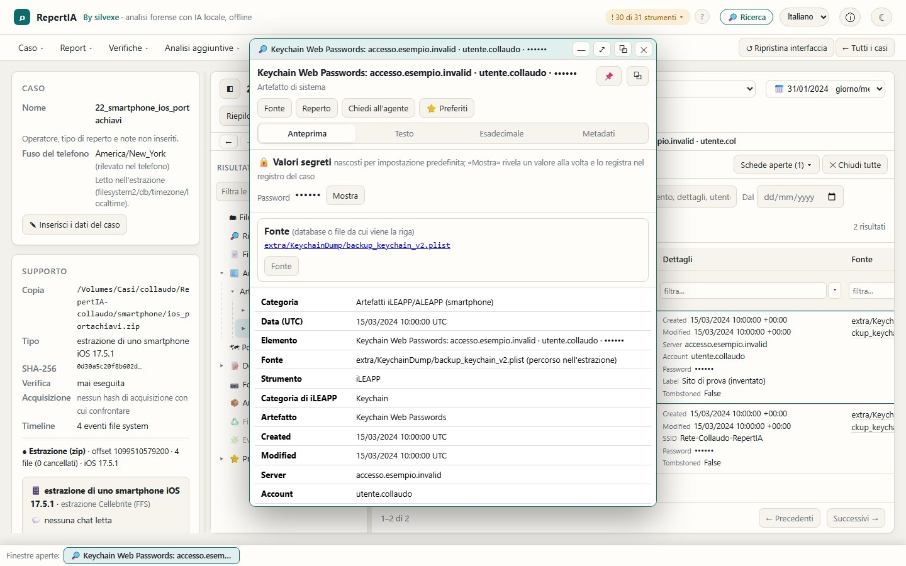

**Reperti dell'IA**: ogni reperto nasce «da verificare» finché l'analista non lo conferma. Qui il n. 1 contiene un errore vero del modello, un'ora locale indicata come UTC: per questo va controllato.

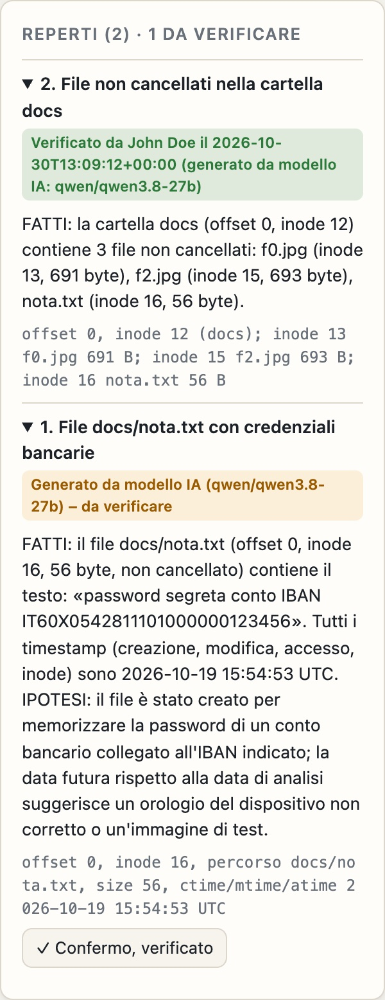

</details>

## Scarica

| Sistema | File |
|---|---|
| Windows (installazione) | [RepertIA-3.0.4-Setup.exe](https://github.com/silvexe/RepertIA/releases/download/v3.0.4/RepertIA-3.0.4-Setup.exe) |
| Windows (portatile) | [RepertIA-3.0.4-Windows.zip](https://github.com/silvexe/RepertIA/releases/download/v3.0.4/RepertIA-3.0.4-Windows.zip) |
| Mac (Apple Silicon) | [RepertIA-3.0.4-Mac.zip](https://github.com/silvexe/RepertIA/releases/download/v3.0.4/RepertIA-3.0.4-Mac.zip) |
| Linux x86_64 (sperimentale) | [RepertIA-3.0.4-Linux.tar.gz](https://github.com/silvexe/RepertIA/releases/download/v3.0.4/RepertIA-3.0.4-Linux.tar.gz) |
| Collaudo | [RepertIA-collaudo.zip](https://github.com/silvexe/RepertIA/releases/download/v3.0.4/RepertIA-collaudo.zip) |
| Impronte SHA-256 | [SHA256SUMS.txt](https://github.com/silvexe/RepertIA/releases/download/v3.0.4/SHA256SUMS.txt) |
| Firma delle impronte | [SHA256SUMS.txt.minisig](https://github.com/silvexe/RepertIA/releases/download/v3.0.4/SHA256SUMS.txt.minisig) |
| Guida illustrata (HTML) | [italiano e inglese](https://github.com/silvexe/RepertIA/releases/download/v3.0.4/RepertIA-guida-3.0.4.html) |

Tutte le versioni: <https://github.com/silvexe/RepertIA/releases>

**Per chi non usa GitHub:** il programma pronto si scarica da questa tabella. Il pulsante verde **Code › Download ZIP**
scarica solo i sorgenti, non il programma da installare.

> **Avvertenza.** RepertIA è un progetto personale, non certificato né validato da un ente terzo e non collegato ad
> alcun ufficio o amministrazione. Lo abbiamo provato su dati di riferimento pubblici (vedi
> [Provato su dati di riferimento pubblici](#provato-su-dati-di-riferimento-pubblici)). I risultati vanno confermati con un secondo strumento o sul dato originale prima di
> usarli in atti. Il software è fornito «così com'è», senza alcuna garanzia (vedi [LICENSE](LICENSE)). Le risposte del
> modello linguistico sono spunti investigativi, non conclusioni.

## Cosa fa

| Area | Funzioni |
|---|---|
| File system | NTFS, FAT/exFAT, ext, HFS+, APFS (anche FileVault con chiave); file cancellati, orfani, ADS; spazio non allocato; copie shadow e snapshot APFS |
| Volumi cifrati | Rilevamento di BitLocker, LUKS, FileVault, VeraCrypt (alta entropia); decifratura di BitLocker, LUKS1 e APFS con la chiave (mai salvata) |
| Artefatti Windows | Per ogni installazione (anche Windows.old): account e accessi (SAM e registri eventi), Prefetch, Amcache, UserAssist, ShimCache, BAM, SRUM, LNK e jump list, ShellBags, Cronologia attività, journal NTFS `$UsnJrnl`, eventi (servizi, accensioni, Desktop remoto, Defender, USB), reti, cestino, browser; dalla 3.0.2 indice di Ricerca di Windows (`Windows.edb`), cronologia di Internet Explorer (`WebCacheV01.dat`), Sticky Notes, Google Drive |
| Artefatti macOS | Volume Dati, quarantena, avvio automatico, TCC, iMessage, documenti recenti, Safari, KnowledgeC, Bluetooth, Time Machine |
| Memoria RAM (3.0.4) | Dump della memoria di computer Windows (raw, mem, vmem, crash dump) letti con MemProcFS, lo stesso motore su Mac, Windows e Linux: processi, connessioni di rete, moduli caricati, driver, attività pianificate, servizi, utenti e timeline della memoria; artefatti di Windows dagli hive del registro ancora in memoria; file ancora in memoria copiati nel caso come copie derivate. Simboli di debug su richiesta, a caso chiuso e con consenso, per lo stato di esecuzione dei servizi; con un caso aperto nessuna richiesta di rete |
| Sorgente logica (3.0.2) | zip, tar, tar.gz, 7z, rar, AD1 di FTK Imager (anche in segmenti; MD5/SHA-1 di FTK ricalcolati per ogni file), immagini di CD/DVD ISO 9660 e UDF, anche CD-R in più sessioni con VAT (i file solo nelle VAT precedenti compaiono come cancellati), o una cartella; database di telefoni riconosciuti dal nome, KML/GPX come livelli della mappa |
| Smartphone (2.20) | Estrazioni del file system completo di iPhone e Android (zip di Cellebrite, GrayKey e altri, tar, tar.gz, cartella) lette senza copiarle; chat WhatsApp, iMessage/SMS e SMS/MMS con vista a fumetti (anche nel report portatile), rubriche, allegati collegati ai file e in anteprima sopra la chat, esportazione delle chat (HTML/CSV con SHA-256); iLEAPP e ALEAPP inclusi, con le chat delle altre app e la vista Chiamate ricavate dai loro risultati; portachiavi di iOS acquisito a parte (es. GrayKey) passato a iLEAPP, a scelta, con i valori segreti nascosti; sysdiagnose di iOS (uno o più) letti con un secondo giro di iLEAPP |
| File citati (2.20) | Percorsi e nomi di file citati da artefatti, allegati delle chat, righe della timeline e risposte dell'agente ritrovati nella copia o nell'estrazione (percorsi del telefono, di Windows e di macOS; campi di cartella e nome uniti; per percorso, hash o nome e dimensione), un riquadro per file con l'esito in tre livelli (✅ trovato con certezza, ⚠️ probabile con i candidati, ❌ non presente) e l'anteprima, anche nel report Word/PDF; allegati WhatsApp verificati con lo SHA-256, miniatura dal database se il file manca |
| Timeline | File system + plaso, dalla 3.0.4 in una pagina a sé; date in UTC, ora italiana o fuso del dispositivo (rilevato), con la sigla del fuso accanto a ogni valore; FAT/exFAT convertiti correttamente |
| Contenuti | Testo dei documenti con ricerca full-text, OCR (Tesseract), metadati EXIF/GPS, archivi, posta PST/OST/MBOX/EML |
| Recupero | Carving con PhotoRec, tracce bulk_extractor, miniature della cache di Esplora file |
| Anomalie | Estensioni false ed eseguibili mascherati (con verifica dei file cancellati contro i falsi positivi), file e contenitori cifrati |
| Immagini e liste | Hash percettivi (immagini simili), liste di hash NSRL, Project VIC / CAID, cartelle di immagini di riferimento |
| Garanzie | Copia mai modificata, hash dei dati confrontati con quelli di acquisizione, registro delle operazioni a catena di hash con voci e hash finale nel report e *Verifica registro* (anche da terminale, `tools/verifica_registro.py`), versioni e impronta del programma nel report |
| Report | Report del caso (Markdown, Word, PDF) e report portatile HTML per chi non ha la copia forense |

Interfaccia, report e testi dei casi **in italiano o in inglese** (la lingua di ogni caso si sceglie alla creazione).

Documentazione completa: [src/README.md](src/README.md) (in inglese: [docs/MANUAL.md](docs/MANUAL.md)). Metodo, collaudi e limiti
noti: [VALIDAZIONE.md](VALIDAZIONE.md) (in inglese: [VALIDATION.md](VALIDATION.md)).

## Scaricare e installare

Dopo aver scaricato il pacchetto del proprio sistema (vedi [Scarica](#scarica)):

| | Mac (Apple Silicon) | Windows 10/11 64 bit | Linux x86_64 (sperimentale) |
|---|---|---|---|
| Installazione | decomprimere e spostare `RepertIA.app` (con Python, plaso e librerie) dove si preferisce; primo avvio: vedi [Primo avvio su Mac](#primo-avvio-su-mac) | eseguire il Setup.exe (senza diritti di amministratore) oppure decomprimere lo zip portatile | estrarre ed eseguire `./installa.sh` (Ubuntu 24.04+, Debian 13) |
| Strumenti esterni | installati al primo avvio con Homebrew | inclusi | installati con apt da `installa.sh`, che prepara anche Python, plaso e le librerie |
| Collaudo | `RepertIA-collaudo.zip` + *Collaudo RepertIA.command* | stesso zip, menu Start › RepertIA › Collaudo | stesso zip, `./collaudo.sh` |
| Modello IA (facoltativo) | LM Studio, llama-server o Ollama, sullo stesso computer o in rete interna | come Mac | come Mac |

**Consiglio:** subito dopo l'installazione esegui il collaudo e conserva il rapporto `collaudo_<data>.md`:
dimostra che su quel computer, con quelle versioni, il programma dà i risultati attesi.

### Verificare i file scaricati

Ogni release contiene `SHA256SUMS.txt` (le impronte di tutti i file) e `SHA256SUMS.txt.minisig`, la firma di quelle impronte
fatta con la chiave dell'autore. La firma dimostra che le impronte vengono dall'autore e non sono state cambiate insieme ai
file. Con [minisign](https://jedisct1.github.io/minisign/) (`brew install minisign` sul Mac; per Windows e Linux gli zip nella
[pagina delle release di minisign](https://github.com/jedisct1/minisign/releases)), nella cartella dei file scaricati:

```bash
minisign -Vm SHA256SUMS.txt -P RWRcYbYmv6AKnsFJMmI0szUorQooceqz0AZ3/9nGrdigNZ4hC6F9KJia
shasum -a 256 -c SHA256SUMS.txt --ignore-missing
```

La prima riga deve dire `Signature and comment signature verified`, la seconda `OK` per ogni file scaricato. Su Windows:
`minisign.exe` per la firma e `certutil -hashfile <file> SHA256` per l'impronta. La chiave pubblica è anche in
[SECURITY.md](SECURITY.md). Le release fino alla 3.0.0 non sono firmate.

### Primo avvio su Mac

RepertIA non è firmata con un certificato Apple a pagamento, quindi la prima volta macOS dice che «non è stato possibile
verificare» l'app e propone solo *Fine* o *Sposta nel Cestino*. Non è un errore del pacchetto: prima controllate che
l'impronta dello zip sia uguale a quella di `SHA256SUMS.txt` (`shasum -a 256 RepertIA-<versione>-Mac.zip` nel Terminale).
Poi, una volta sola:

1. Decomprimete lo zip e spostate `RepertIA.app` dove preferite (per esempio in *Applicazioni*).
2. Fate doppio clic su `RepertIA.app`. Compare l'avviso: premete **Fine** (non *Sposta nel Cestino*).
3. Aprite **Impostazioni di Sistema › Privacy e sicurezza** e scorrete fino alla sezione *Sicurezza*: c'è la riga
   «L'apertura di "RepertIA" è stata bloccata…». Premete **Apri comunque** e confermate con la password del Mac o con
   Touch ID.
4. Fate di nuovo doppio clic su `RepertIA.app` e nella finestra che compare premete **Apri comunque**.

Da quel momento l'app si apre normalmente, anche dopo il riavvio. Il pulsante *Apri comunque* resta disponibile per circa
un'ora dopo il tentativo del punto 2: se non lo trovate, ripetete il doppio clic. Su macOS 15 e successivi il vecchio
metodo «tasto destro › Apri» non basta più. La stessa procedura vale per *Collaudo RepertIA.command* e
*Aggiorna strumenti.command*, la prima volta che li aprite.

In alternativa, chi usa il Terminale può togliere il blocco a tutta l'app con un solo comando (adattate il percorso):

```bash
xattr -dr com.apple.quarantine /Applications/RepertIA.app
```

### Requisiti

**Computer (senza IA)**
- **Sistema**: Mac con chip Apple Silicon (M1 o successivo), Windows 10/11 a 64 bit, oppure Linux x86_64 con Ubuntu 24.04
  o successivo (versione sperimentale).
- **Memoria (RAM)**: 8 GB bastano per pendrive e dischi piccoli; con 16 GB si lavora comodi.
- **Disco**: meglio un SSD. Il caso non è una copia del disco ma un database con gli indici; a questo si aggiunge lo spazio
  per i file esportati, il carving e la cache delle anteprime (al massimo circa 5 GB per caso). La copia forense può stare
  anche su un disco esterno, ma conviene USB 3 o Thunderbolt, perché il calcolo degli hash la rilegge tutta.
- **Processore**: più core accorciano soprattutto la timeline di plaso, che su dischi grandi può durare ore.

**Modello IA locale (facoltativo)**: serve un modello che supporti il *tool calling*, con un contesto di almeno 16k token
(meglio 32k). Indicativamente:

| Memoria per il modello | Modelli | Risultato |
|---|---|---|
| 16 GB di RAM (o GPU da 8 GB) | Qwen3.5-9B | solo domande semplici |
| 32 GB (o GPU da 16 GB) | gpt-oss-20b | già accettabile |
| 48–64 GB (o GPU da 24–32 GB) | Qwen3.8-27B, Qwen3.6-35B-A3B, Gemma 4 31B | consigliato |
| 128 GB | gpt-oss-120b | il massimo in locale |

Si carica il modello (LM Studio, llama-server od Ollama) con un contesto di circa 32768, si avvia il server e RepertIA lo
trova da solo. Sul Mac la memoria è condivisa: lasciate una decina di GB liberi per il sistema. Senza scheda video il
modello gira sul processore, ma è lento; con *Server in rete* un solo computer potente della rete interna può servire più
postazioni. Senza modello RepertIA funziona comunque: tutti i dati restano consultabili. Le indicazioni sui modelli vengono
da classifiche pubbliche (ottobre 2026): verificatele sui vostri casi.

### Dai sorgenti

```
git clone https://github.com/silvexe/RepertIA.git
cd RepertIA/src
python3 forense_gui.py          # Python 3.12; servono The Sleuth Kit, libewf e i moduli libyal (vedi src/README.md)
```

Come costruire i pacchetti: [docs/COSTRUZIONE.md](docs/COSTRUZIONE.md).

## IA, tracciabilità e normativa

- **Nessuna API di terze parti.** Il modello linguistico è open-weight e gira sul computer dell'analista (LM Studio,
  llama-server od Ollama) o, se lo si sceglie, su un server della rete interna, indicato nel report. RepertIA ci parla con
  il protocollo compatibile OpenAI ma solo verso quel server: niente cloud, account o telemetria. Internet serve solo per
  installare o aggiornare gli strumenti, mai durante l'analisi. Chi vuole tutta la catena open source può usare llama-server.
- **Tutto è registrato.** Il registro del caso (`audit_log.jsonl`, concatenato con SHA-256 e verificabile con *Verifica
  hash*) contiene ogni domanda, ogni risposta del modello (con il «ragionamento», se il modello lo espone), ogni strumento
  richiamato con i parametri e il risultato, e il modello, il server e il contesto usati. Si può ricostruire la catena
  domanda → ricerche → dati letti → risposta. Non sono spiegabili i pesi interni del modello, come per ogni LLM, e le
  risposte non sono riproducibili alla lettera.
- **L'IA non decide.** Usa solo strumenti in sola lettura (al massimo 40 passaggi per domanda), cita file, offset e inode
  da verificare e propone spunti investigativi; le conclusioni restano all'analista. Senza modello il programma funziona
  comunque. RepertIA **non fa riconoscimento biometrico** (gli hash percettivi trovano immagini simili, non persone).
- **Permessi.** Non servono diritti di amministratore per RepertIA (servono solo per installare gli strumenti di sistema:
  Homebrew sul Mac, apt su Linux). La copia forense è aperta in sola lettura; l'interfaccia ascolta solo su 127.0.0.1 con
  un codice casuale a ogni avvio.
- **Normativa.** L'uso di sistemi di IA da parte di forze di polizia e uffici giudiziari è regolato dal regolamento
  europeo sull'IA (Reg. UE 2024/1689) e, in Italia, dalla legge 132/2025 e dai decreti di attuazione. RepertIA è un
  progetto personale, non certificato: **chi lo usa per attività d'ufficio deve valutarne la conformità e farlo autorizzare
  secondo le regole della propria amministrazione** (per esempio valutazione d'impatto e supervisione umana). Questa
  sezione non è un parere legale.
- **AI Act (2.20.1).** Scopo previsto, usi esclusi, valutazione ai sensi dell'art. 6, par. 3, come sono rispettati gli
  obblighi di trasparenza dell'art. 50 (reperti dell'IA «da verificare» finché l'analista non li conferma, etichetta sotto
  ogni risposta, metadati IA nei report Word/PDF, avviso prima di usare un server LLM esterno) e nota per gli uffici che lo
  adottano: **[AI_ACT.md](AI_ACT.md)**.

## Collaudo

`src/forense_collaudo.py` prepara un caso per ogni immagine di prova e confronta i risultati con i valori attesi di
[`collaudo/`](collaudo/): immagini pubbliche con risultati pubblicati da terzi (DFTT) e immagini costruite per il
collaudo. Le immagini sono nell'archivio `RepertIA-collaudo.zip` tra le Releases. Dettagli in
[collaudo/README.md](collaudo/README.md) e [VALIDAZIONE.md](VALIDAZIONE.md).

## Licenza

Copyright (C) 2026 silvexe.

RepertIA è software libero: puoi ridistribuirlo e/o modificarlo secondo i termini della **GNU Affero General Public License**
pubblicata dalla Free Software Foundation, **versione 3 o (a tua scelta) qualsiasi versione successiva**
(SPDX: `AGPL-3.0-or-later`). È distribuito nella speranza che sia utile, ma SENZA ALCUNA GARANZIA. Testo completo in
[LICENSE](LICENSE).

Dalla 3.0.0 si applica questa licenza; le versioni fino alla 2.21.0 restano sotto GPL-3.0-or-later.

**In pratica.** Chiunque può usare RepertIA gratis, anche per il proprio lavoro professionale a pagamento. Chi lo
inserisce in un software che distribuisce o offre in rete deve pubblicarne il codice sorgente con la stessa licenza: non
può diventare un prodotto chiuso.

**Permesso aggiuntivo (AGPL, sezione 7).** RepertIA carica `pytsk3`, che contiene The Sleuth Kit, le cui parti sotto CPL-1.0 e
IPL-1.0 non sono compatibili con la GPL. L'autore permette in aggiunta di combinare RepertIA con `pytsk3` e The Sleuth Kit e di
distribuire il risultato, rispettando per quei componenti le loro licenze. Chi modifica RepertIA può togliere questo permesso
dalla propria versione. Non permette altro: tutto il resto del programma resta sotto AGPL.

I pacchetti delle Releases includono componenti di terze parti con le loro licenze: elenco, versioni e fonti in
[THIRD_PARTY_LICENSES.md](THIRD_PARTY_LICENSES.md).

## Chi lavora al progetto

- **Autore e responsabile:** [silvexe](https://github.com/silvexe).
- **Contributor:** [nannib](https://github.com/nannib) — idee e indicazioni per migliorare lo strumento.

## Come è stato sviluppato

Il codice è stato scritto con l'ausilio di Claude, modello di intelligenza artificiale di Anthropic. Scelte
progettuali, verifiche e collaudi sono dell'autore. Ogni versione è descritta in [CHANGELOG.md](CHANGELOG.md) con
cosa cambia, come è stata provata e cosa non è stato provato.

## Contribuire e segnalare problemi

- Problemi e proposte: sezione **Issues**. **Non allegare mai dati di casi reali** (copie, estratti, schermate con
  nomi o percorsi): usa immagini di prova pubbliche o costruite.
- Contributi: [CONTRIBUTING.md](CONTRIBUTING.md).
- Vulnerabilità: [SECURITY.md](SECURITY.md) (segnalazione privata).
