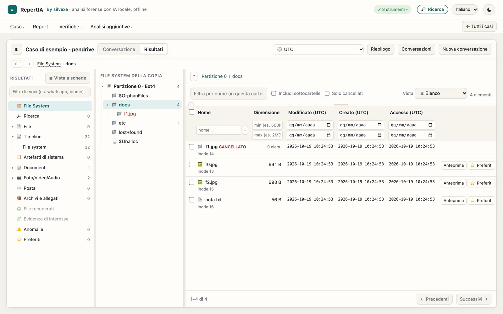
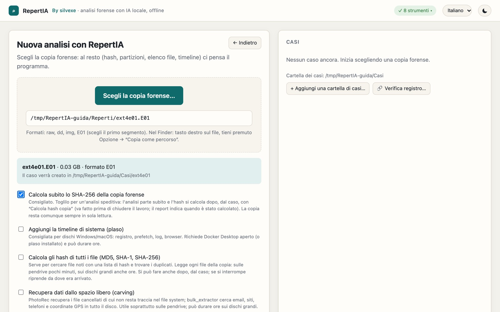
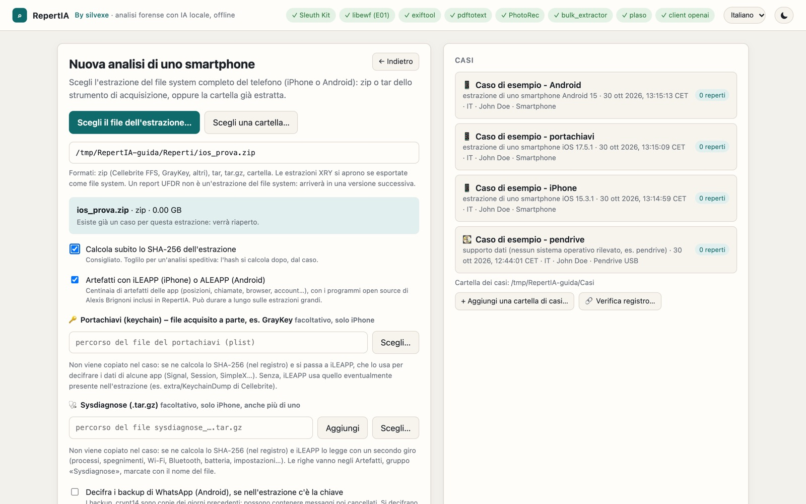
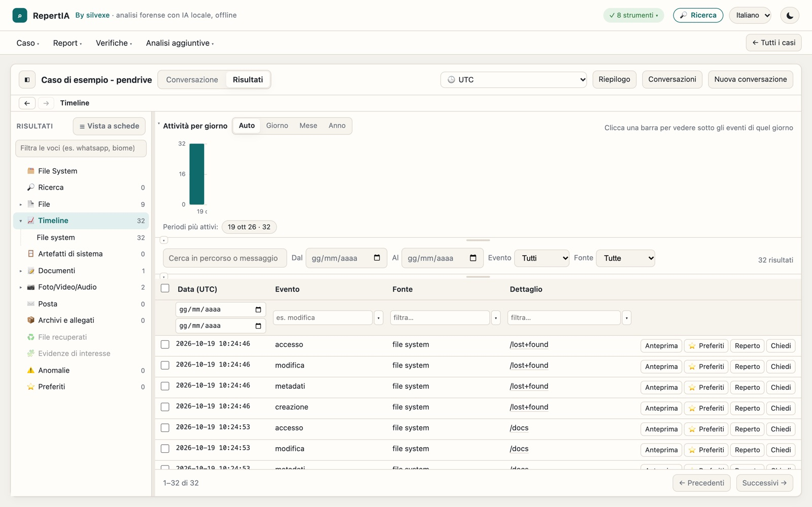
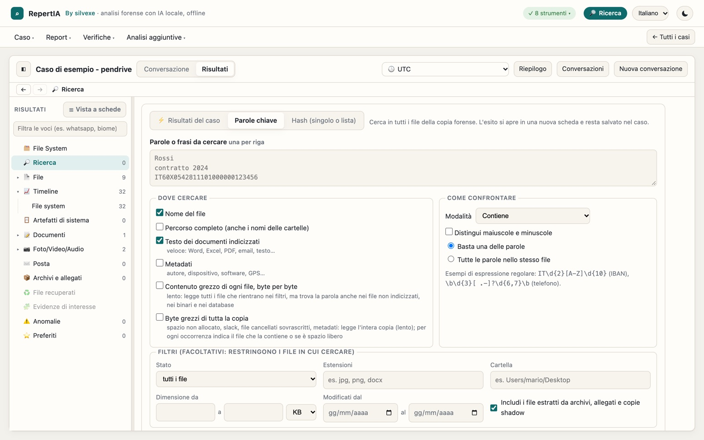
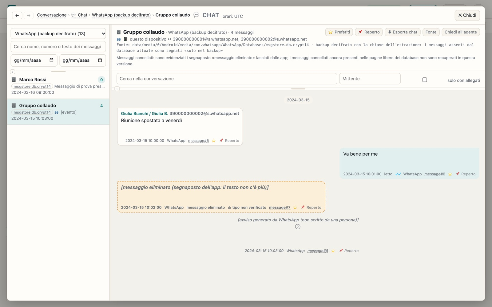
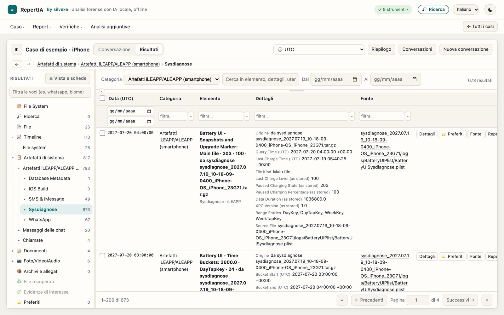
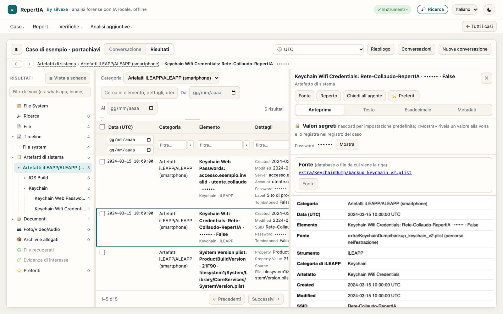
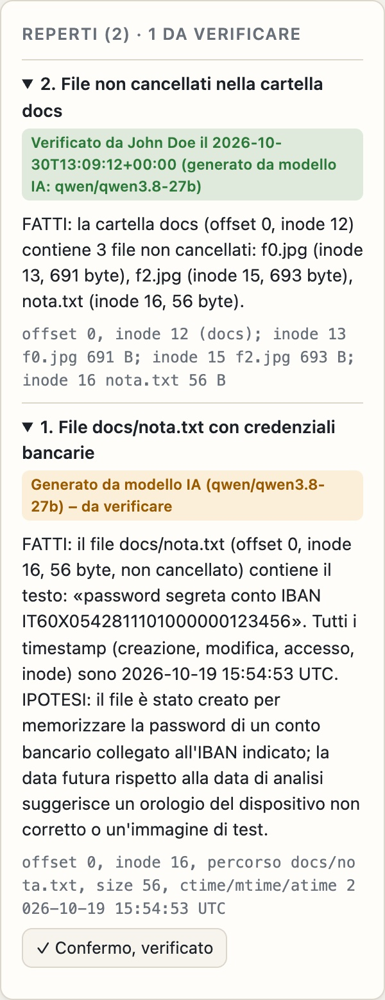

# RepertIA

**Analisi forense di copie di dischi e pendrive ed estrazioni di smartphone, con intelligenza artificiale locale e offline.**
🇬🇧 **English version: [README.md](README.md)**

RepertIA analizza copie forensi (E01, raw/dd, dmg) e, dalla 2.20, estrazioni del file system completo di iPhone e telefoni
Android da un'unica interfaccia web locale, su Mac Apple Silicon, Windows o
Linux (sperimentale).
Usa strumenti forensi riconosciuti (The Sleuth Kit, libewf, plaso, PhotoRec, bulk_extractor, ExifTool, libyal) e ne
raccoglie i risultati in un caso consultabile con filtri, timeline e anteprime. Un modello linguistico che gira sul
computer dell'analista (facoltativo) risponde a domande in italiano o in inglese citando file, offset e inode.
**Nessun dato lascia il computer**: niente cloud, account o telemetria; l'interfaccia ascolta solo su 127.0.0.1.

**RepertIA funziona completamente SENZA intelligenza artificiale.** Il modello IA locale **non è incluso** nei
pacchetti: è una scelta facoltativa dell'utente (LM Studio, llama-server od Ollama), che si può usare o meno. Senza
modello tutte le analisi, le ricerche e i report funzionano lo stesso.

## Schermate

*Schermate reali di RepertIA, realizzate con dati di prova pubblici o costruiti e nomi di fantasia.*



### Che cosa si può caricare

| Memorie di massa | Smartphone |
|---|---|
|  |  |
| Copie forensi di dischi, SSD, pendrive e schede: E01, raw/dd, img, dmg | Estrazioni del file system completo di iPhone e Android (Cellebrite, GrayKey, altri): zip, tar, tar.gz o cartella. Facoltativi: portachiavi e sysdiagnose di iOS |

<details>
<summary><b>Altre schermate</b></summary>

<br>

**Timeline**: grafico dell'attività ed eventi, con filtri per data, evento e fonte.



**Ricerca**: parole, espressioni regolari o hash, fino ai byte grezzi della copia.



**Chat**: conversazioni con database, tabella e riga di ogni messaggio. Qui un backup WhatsApp decifrato (backup e chiave finti).



**Sysdiagnose di iOS**: acquisiti a parte e letti con iLEAPP.



**Portachiavi**: password, chiavi e token restano nascosti; mostrarne uno viene registrato (portachiavi finto).



**Reperti dell'IA**: ogni reperto nasce «da verificare» finché l'analista non lo conferma. Qui il n. 1 contiene un errore vero del modello, un'ora locale indicata come UTC: per questo va controllato.



</details>

## Scarica

| Sistema | File |
|---|---|
| Windows (installazione) | [RepertIA-2.20.2-Setup.exe](https://github.com/silvexe/RepertIA/releases/download/v2.20.2/RepertIA-2.20.2-Setup.exe) |
| Windows (portatile) | [RepertIA-2.20.2-Windows.zip](https://github.com/silvexe/RepertIA/releases/download/v2.20.2/RepertIA-2.20.2-Windows.zip) |
| Mac (Apple Silicon) | [RepertIA-2.20.2-Mac.zip](https://github.com/silvexe/RepertIA/releases/download/v2.20.2/RepertIA-2.20.2-Mac.zip) |
| Linux x86_64 (sperimentale) | [RepertIA-2.20.2-Linux.tar.gz](https://github.com/silvexe/RepertIA/releases/download/v2.20.2/RepertIA-2.20.2-Linux.tar.gz) |
| Collaudo | [RepertIA-collaudo.zip](https://github.com/silvexe/RepertIA/releases/download/v2.20.2/RepertIA-collaudo.zip) |
| Impronte SHA-256 | [SHA256SUMS.txt](https://github.com/silvexe/RepertIA/releases/download/v2.20.2/SHA256SUMS.txt) |
| Guida illustrata (PDF) | [Italiano](docs/guida/RepertIA-guida-illustrata-2.20.2-IT.pdf) · [English](docs/guida/RepertIA-illustrated-guide-2.20.2-EN.pdf) |

Tutte le versioni: <https://github.com/silvexe/RepertIA/releases>

**Per chi non usa GitHub:** il programma pronto si scarica da questa tabella. Il pulsante verde **Code › Download ZIP**
scarica solo i sorgenti, non il programma da installare.

> **Avvertenza.** RepertIA è un progetto personale, non certificato né validato da un ente terzo e non collegato ad
> alcun ufficio o amministrazione. I risultati vanno confermati con un secondo strumento o sul dato originale prima di
> usarli in atti. Il software è fornito «così com'è», senza alcuna garanzia (vedi [LICENSE](LICENSE)). Le risposte del
> modello linguistico sono spunti investigativi, non conclusioni.

## Cosa fa

| Area | Funzioni |
|---|---|
| File system | NTFS, FAT/exFAT, ext, HFS+, APFS (anche FileVault con chiave); file cancellati, orfani, ADS; spazio non allocato; copie shadow e snapshot APFS |
| Volumi cifrati | Rilevamento di BitLocker, LUKS, FileVault, VeraCrypt (alta entropia); decifratura di BitLocker, LUKS1 e APFS con la chiave (mai salvata) |
| Artefatti Windows | Per ogni installazione (anche Windows.old): account e accessi (SAM e registri eventi), Prefetch, Amcache, UserAssist, ShimCache, BAM, SRUM, LNK e jump list, ShellBags, Cronologia attività, journal NTFS `$UsnJrnl`, eventi (servizi, accensioni, Desktop remoto, Defender, USB), reti, cestino, browser |
| Artefatti macOS | Volume Dati, quarantena, avvio automatico, TCC, iMessage, documenti recenti, Safari, KnowledgeC, Bluetooth, Time Machine |
| Smartphone (2.20) | Estrazioni del file system completo di iPhone e Android (zip di Cellebrite, GrayKey e altri, tar, tar.gz, cartella) lette senza copiarle; chat WhatsApp, iMessage/SMS e SMS/MMS con vista a fumetti (anche nel report portatile), rubriche, allegati collegati ai file e in anteprima sopra la chat, esportazione delle chat (HTML/CSV con SHA-256); iLEAPP e ALEAPP inclusi, con le chat delle altre app e la vista Chiamate ricavate dai loro risultati; portachiavi di iOS acquisito a parte (es. GrayKey) passato a iLEAPP, a scelta, con i valori segreti nascosti; sysdiagnose di iOS (uno o più) letti con un secondo giro di iLEAPP |
| File citati (2.20) | Percorsi e nomi di file citati da artefatti, allegati delle chat, righe della timeline e risposte dell'agente ritrovati nella copia o nell'estrazione (percorsi del telefono, di Windows e di macOS; campi di cartella e nome uniti; per percorso, hash o nome e dimensione), un riquadro per file con l'esito in tre livelli (✅ trovato con certezza, ⚠️ probabile con i candidati, ❌ non presente) e l'anteprima, anche nel report Word/PDF; allegati WhatsApp verificati con lo SHA-256, miniatura dal database se il file manca |
| Timeline | File system + plaso; date in UTC, ora italiana o fuso del dispositivo (rilevato), FAT/exFAT convertiti correttamente |
| Contenuti | Testo dei documenti con ricerca full-text, OCR (Tesseract), metadati EXIF/GPS, archivi, posta PST/OST/MBOX/EML |
| Recupero | Carving con PhotoRec, tracce bulk_extractor, miniature della cache di Esplora file |
| Anomalie | Estensioni false ed eseguibili mascherati (con verifica dei file cancellati contro i falsi positivi), file e contenitori cifrati |
| Immagini e liste | Hash percettivi (immagini simili), liste di hash NSRL, Project VIC / CAID, cartelle di immagini di riferimento |
| Garanzie | Copia mai modificata, hash dei dati confrontati con quelli di acquisizione, registro delle operazioni a catena di hash con voci e hash finale nel report e *Verifica registro* (anche da terminale, `tools/verifica_registro.py`), versioni e impronta del programma nel report |
| Report | Report del caso (Markdown, Word, PDF) e report portatile HTML per chi non ha la copia forense |

Interfaccia, report e testi dei casi **in italiano o in inglese** (la lingua di ogni caso si sceglie alla creazione).

Documentazione completa: [src/README.md](src/README.md) (in inglese: [docs/MANUAL.md](docs/MANUAL.md)). Metodo, collaudi e limiti
noti: [VALIDAZIONE.md](VALIDAZIONE.md) (in inglese: [VALIDATION.md](VALIDATION.md)).

## Scaricare e installare

Dopo aver scaricato il pacchetto del proprio sistema (vedi [Scarica](#scarica)):

| | Mac (Apple Silicon) | Windows 10/11 64 bit | Linux x86_64 (sperimentale) |
|---|---|---|---|
| Installazione | decomprimere e spostare `RepertIA.app` (con Python, plaso e librerie) dove si preferisce; primo avvio: tasto destro › Apri | eseguire il Setup.exe (senza diritti di amministratore) oppure decomprimere lo zip portatile | estrarre ed eseguire `./installa.sh` (Ubuntu 24.04+, Debian 13) |
| Strumenti esterni | installati al primo avvio con Homebrew | inclusi | installati con apt da `installa.sh`, che prepara anche Python, plaso e le librerie |
| Collaudo | `RepertIA-collaudo.zip` + *Collaudo RepertIA.command* | stesso zip, menu Start › RepertIA › Collaudo | stesso zip, `./collaudo.sh` |
| Modello IA (facoltativo) | LM Studio, llama-server o Ollama, sullo stesso computer o in rete interna | come Mac | come Mac |

**Consiglio:** subito dopo l'installazione esegui il collaudo e conserva il rapporto `collaudo_<data>.md`:
dimostra che su quel computer, con quelle versioni, il programma dà i risultati attesi.

### Requisiti

**Computer (senza IA)**
- **Sistema**: Mac con chip Apple Silicon (M1 o successivo), Windows 10/11 a 64 bit, oppure Linux x86_64 con Ubuntu 24.04
  o successivo (versione sperimentale).
- **Memoria (RAM)**: 8 GB bastano per pendrive e dischi piccoli; con 16 GB si lavora comodi.
- **Disco**: meglio un SSD. Il caso non è una copia del disco ma un database con gli indici; a questo si aggiunge lo spazio
  per i file esportati, il carving e la cache delle anteprime (al massimo circa 5 GB per caso). La copia forense può stare
  anche su un disco esterno, ma conviene USB 3 o Thunderbolt, perché il calcolo degli hash la rilegge tutta.
- **Processore**: più core accorciano soprattutto la timeline di plaso, che su dischi grandi può durare ore.

**Modello IA locale (facoltativo)**: serve un modello che supporti il *tool calling*, con un contesto di almeno 16k token
(meglio 32k). Indicativamente:

| Memoria per il modello | Modelli | Risultato |
|---|---|---|
| 16 GB di RAM (o GPU da 8 GB) | Qwen3.5-9B | solo domande semplici |
| 32 GB (o GPU da 16 GB) | gpt-oss-20b | già accettabile |
| 48–64 GB (o GPU da 24–32 GB) | Qwen3.8-27B, Qwen3.6-35B-A3B, Gemma 4 31B | consigliato |
| 128 GB | gpt-oss-120b | il massimo in locale |

Si carica il modello (LM Studio, llama-server od Ollama) con un contesto di circa 32768, si avvia il server e RepertIA lo
trova da solo. Sul Mac la memoria è condivisa: lasciate una decina di GB liberi per il sistema. Senza scheda video il
modello gira sul processore, ma è lento; con *Server in rete* un solo computer potente della rete interna può servire più
postazioni. Senza modello RepertIA funziona comunque: tutti i dati restano consultabili. Le indicazioni sui modelli vengono
da classifiche pubbliche (ottobre 2026): verificatele sui vostri casi.

### Dai sorgenti

```
git clone https://github.com/silvexe/RepertIA.git
cd RepertIA/src
python3 forense_gui.py          # Python 3.12; servono The Sleuth Kit, libewf e i moduli libyal (vedi src/README.md)
```

Come costruire i pacchetti: [docs/COSTRUZIONE.md](docs/COSTRUZIONE.md).

## IA, tracciabilità e normativa

- **Nessuna API di terze parti.** Il modello linguistico è open-weight e gira sul computer dell'analista (LM Studio,
  llama-server od Ollama) o, se lo si sceglie, su un server della rete interna, indicato nel report. RepertIA ci parla con
  il protocollo compatibile OpenAI ma solo verso quel server: niente cloud, account o telemetria. Internet serve solo per
  installare o aggiornare gli strumenti, mai durante l'analisi. Chi vuole tutta la catena open source può usare llama-server.
- **Tutto è registrato.** Il registro del caso (`audit_log.jsonl`, concatenato con SHA-256 e verificabile con *Verifica
  hash*) contiene ogni domanda, ogni risposta del modello (con il «ragionamento», se il modello lo espone), ogni strumento
  richiamato con i parametri e il risultato, e il modello, il server e il contesto usati. Si può ricostruire la catena
  domanda → ricerche → dati letti → risposta. Non sono spiegabili i pesi interni del modello, come per ogni LLM, e le
  risposte non sono riproducibili alla lettera.
- **L'IA non decide.** Usa solo strumenti in sola lettura (al massimo 40 passaggi per domanda), cita file, offset e inode
  da verificare e propone spunti investigativi; le conclusioni restano all'analista. Senza modello il programma funziona
  comunque. RepertIA **non fa riconoscimento biometrico** (gli hash percettivi trovano immagini simili, non persone).
- **Permessi.** Non servono diritti di amministratore per RepertIA (servono solo per installare gli strumenti di sistema:
  Homebrew sul Mac, apt su Linux). La copia forense è aperta in sola lettura; l'interfaccia ascolta solo su 127.0.0.1 con
  un codice casuale a ogni avvio.
- **Normativa.** L'uso di sistemi di IA da parte di forze di polizia e uffici giudiziari è regolato dal regolamento
  europeo sull'IA (Reg. UE 2024/1689) e, in Italia, dalla legge 132/2025 e dai decreti di attuazione. RepertIA è un
  progetto personale, non certificato: **chi lo usa per attività d'ufficio deve valutarne la conformità e farlo autorizzare
  secondo le regole della propria amministrazione** (per esempio valutazione d'impatto e supervisione umana). Questa
  sezione non è un parere legale.
- **AI Act (2.20.1).** Scopo previsto, usi esclusi, valutazione ai sensi dell'art. 6, par. 3, come sono rispettati gli
  obblighi di trasparenza dell'art. 50 (reperti dell'IA «da verificare» finché l'analista non li conferma, etichetta sotto
  ogni risposta, metadati IA nei report Word/PDF, avviso prima di usare un server LLM esterno) e nota per gli uffici che lo
  adottano: **[AI_ACT.md](AI_ACT.md)**.

## Collaudo

`src/forense_collaudo.py` prepara un caso per ogni immagine di prova e confronta i risultati con i valori attesi di
[`collaudo/`](collaudo/): immagini pubbliche con risultati pubblicati da terzi (DFTT) e immagini costruite per il
collaudo. Le immagini sono nell'archivio `RepertIA-collaudo.zip` tra le Releases. Dettagli in
[collaudo/README.md](collaudo/README.md) e [VALIDAZIONE.md](VALIDAZIONE.md).

## Licenza

Copyright (C) 2026 silvexe.

RepertIA è software libero: puoi ridistribuirlo e/o modificarlo secondo i termini della **GNU General Public License**
pubblicata dalla Free Software Foundation, **versione 3 o (a tua scelta) qualsiasi versione successiva**
(SPDX: `GPL-3.0-or-later`). È distribuito nella speranza che sia utile, ma SENZA ALCUNA GARANZIA. Testo completo in
[LICENSE](LICENSE).

I pacchetti delle Releases includono componenti di terze parti con le loro licenze: elenco, versioni e fonti in
[THIRD_PARTY_LICENSES.md](THIRD_PARTY_LICENSES.md).

## Come è stato sviluppato

Il codice è stato scritto con l'ausilio di Claude, modello di intelligenza artificiale di Anthropic. Scelte
progettuali, verifiche e collaudi sono dell'autore. Ogni versione è descritta in [CHANGELOG.md](CHANGELOG.md) con
cosa cambia, come è stata provata e cosa non è stato provato.

## Contribuire e segnalare problemi

- Problemi e proposte: sezione **Issues**. **Non allegare mai dati di casi reali** (copie, estratti, schermate con
  nomi o percorsi): usa immagini di prova pubbliche o costruite.
- Contributi: [CONTRIBUTING.md](CONTRIBUTING.md).
- Vulnerabilità: [SECURITY.md](SECURITY.md) (segnalazione privata).
