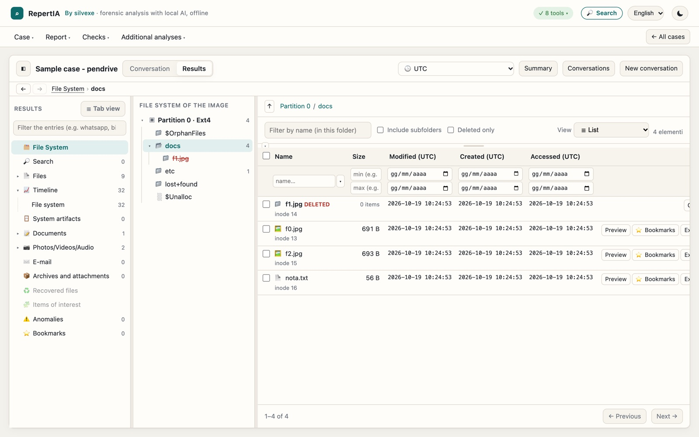
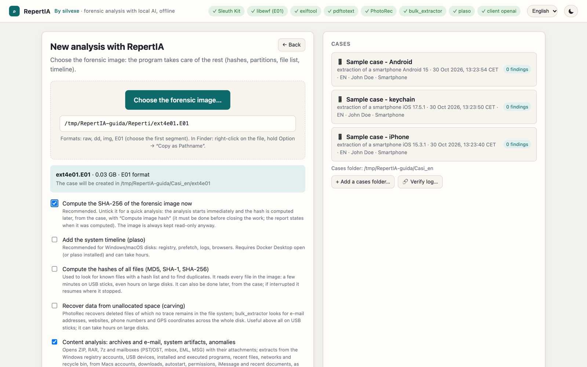
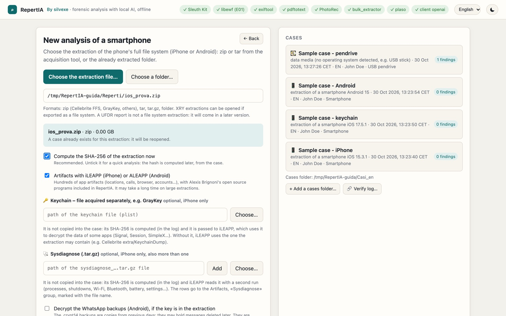
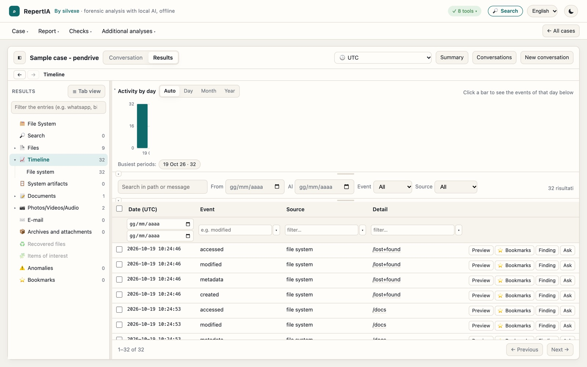
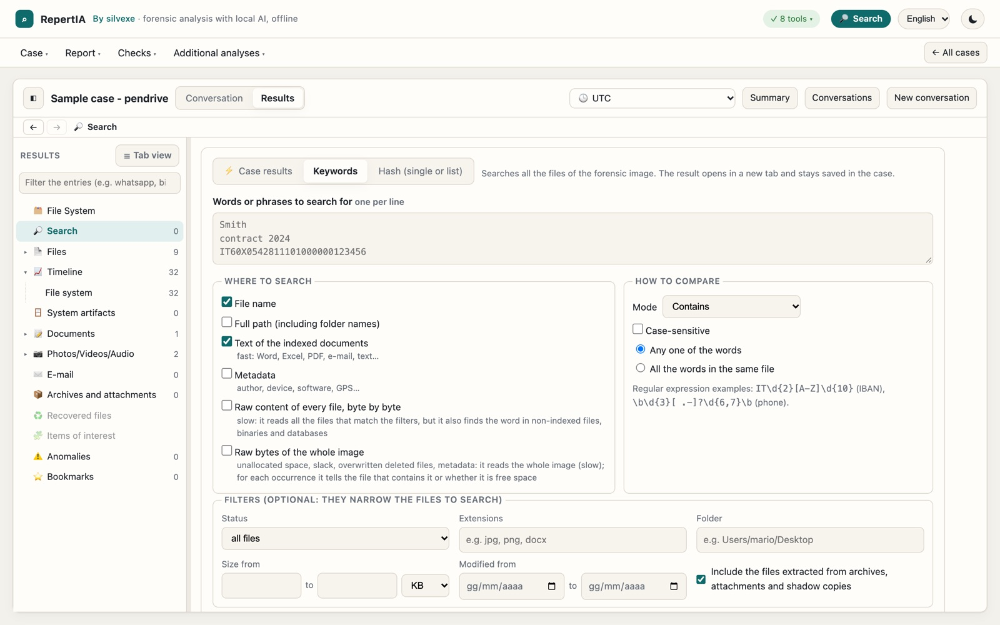
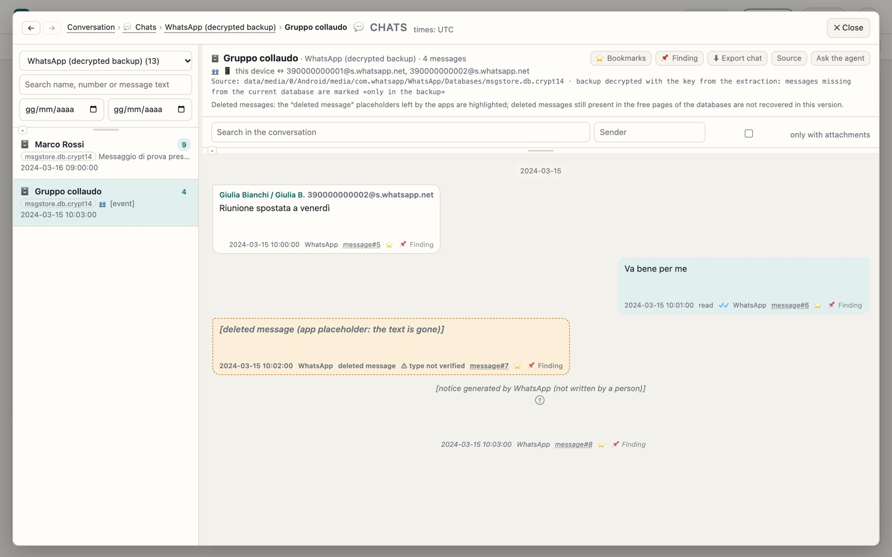
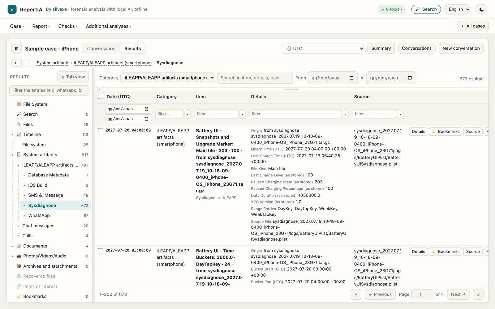
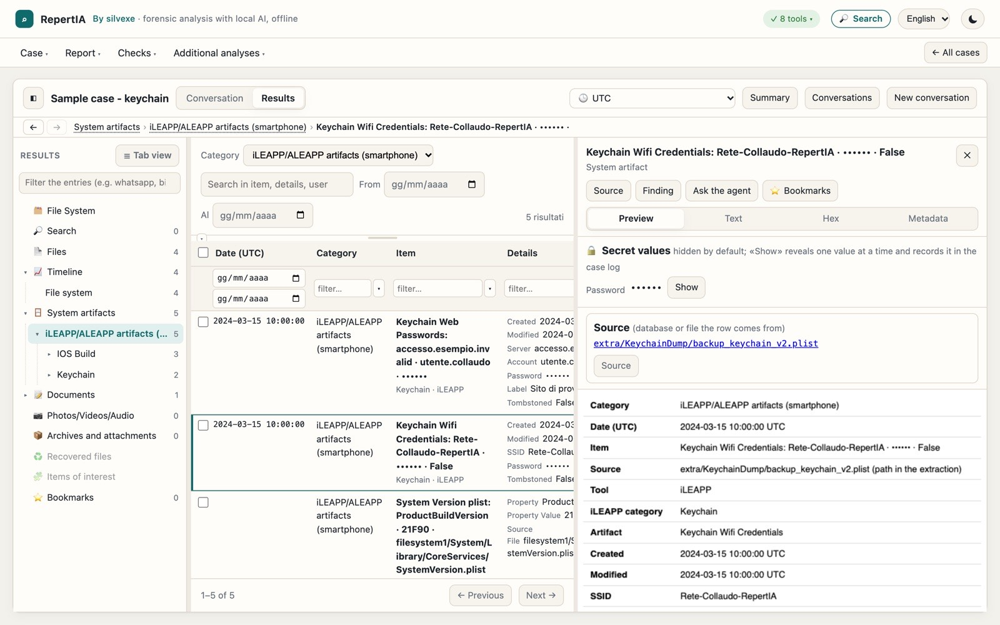
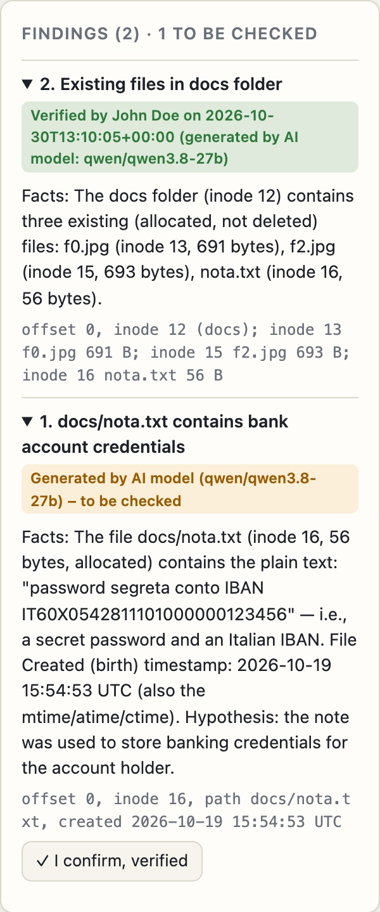

# RepertIA

**Forensic analysis of disk and USB drive images and smartphone extractions, with a local, offline AI assistant.**
🇮🇹 **Versione italiana: [README.it.md](README.it.md)**

📘 **Illustrated guide (PDF):** [English](https://github.com/silvexe/RepertIA/releases/download/v2.20.3/RepertIA-illustrated-guide-2.20.3-EN.pdf) · [Italiano](https://github.com/silvexe/RepertIA/releases/download/v2.20.3/RepertIA-guida-illustrata-2.20.3-IT.pdf)

RepertIA analyses forensic images (E01, raw/dd, dmg) and, from 2.20, full file system extractions of iPhones and Android
phones from a single local web interface, on Apple Silicon Macs, Windows
or Linux (experimental). It uses established forensic tools (The Sleuth Kit, libewf, plaso, PhotoRec, bulk_extractor,
ExifTool, libyal) and gathers their results into a case you can browse with filters, timelines and previews. An optional
language model running on the analyst's own computer answers questions in English or Italian, citing files, offsets and
inodes.
**No data leaves the computer**: no cloud, no accounts, no telemetry; the interface listens only on 127.0.0.1.

**RepertIA works completely WITHOUT artificial intelligence.** The local AI model is **not included** in the packages:
it is an optional choice of the user (LM Studio, llama-server or Ollama), which can be used or not. Without a model all
analyses, searches and reports work just the same.

## Screenshots

*Real screenshots of RepertIA, made with public or constructed test data and fictional names.*



### What you can load

| Mass storage | Smartphones |
|---|---|
|  |  |
| Forensic copies of disks, SSDs, pendrives and cards: E01, raw/dd, img, dmg | Full file system extractions of iPhone and Android (Cellebrite, GrayKey, others): zip, tar, tar.gz or folder. Optional: iOS keychain and sysdiagnose |

<details>
<summary><b>More screenshots</b></summary>

<br>

**Timeline**: activity chart and events, with filters by date, event and source.



**Search**: words, regular expressions or hashes, down to the raw bytes of the copy.



**Chats**: conversations with database, table and row of each message. Here a decrypted WhatsApp backup (fake backup and key).



**iOS sysdiagnose**: acquired separately and read with iLEAPP.



**Keychain**: passwords, keys and tokens stay hidden; showing one is recorded in the log (fake keychain).



**AI findings**: every finding starts as "to be checked" until the analyst confirms it. No. 1 here contains a real model error, a local time labelled as UTC: that is why it must be checked.



</details>

## Download

| System | File |
|---|---|
| Windows (installer) | [RepertIA-2.20.3-Setup.exe](https://github.com/silvexe/RepertIA/releases/download/v2.20.3/RepertIA-2.20.3-Setup.exe) |
| Windows (portable) | [RepertIA-2.20.3-Windows.zip](https://github.com/silvexe/RepertIA/releases/download/v2.20.3/RepertIA-2.20.3-Windows.zip) |
| Mac (Apple Silicon) | [RepertIA-2.20.3-Mac.zip](https://github.com/silvexe/RepertIA/releases/download/v2.20.3/RepertIA-2.20.3-Mac.zip) |
| Linux x86_64 (experimental) | [RepertIA-2.20.3-Linux.tar.gz](https://github.com/silvexe/RepertIA/releases/download/v2.20.3/RepertIA-2.20.3-Linux.tar.gz) |
| Acceptance test (*collaudo*) | [RepertIA-collaudo.zip](https://github.com/silvexe/RepertIA/releases/download/v2.20.3/RepertIA-collaudo.zip) |
| SHA-256 checksums | [SHA256SUMS.txt](https://github.com/silvexe/RepertIA/releases/download/v2.20.3/SHA256SUMS.txt) |
| Illustrated guide (PDF) | [English](https://github.com/silvexe/RepertIA/releases/download/v2.20.3/RepertIA-illustrated-guide-2.20.3-EN.pdf) · [Italiano](https://github.com/silvexe/RepertIA/releases/download/v2.20.3/RepertIA-guida-illustrata-2.20.3-IT.pdf) |

All versions: <https://github.com/silvexe/RepertIA/releases>

**If you do not use GitHub:** download the ready-to-use program from this table. The green **Code › Download ZIP**
button downloads only the source code, not the program to install.

> **Disclaimer.** RepertIA is a personal project. It is not certified or validated by any third party and is not
> affiliated with any office or public administration. Results must be confirmed with a second tool or on the original
> data before being used in official reports or proceedings. The software is provided "as is", without any warranty
> (see [LICENSE](LICENSE)). The language model's answers are investigative leads, not conclusions.

## What it does

| Area | Features |
|---|---|
| File systems | NTFS, FAT/exFAT, ext, HFS+, APFS (FileVault too, with the key); deleted and orphan files, ADS; unallocated space; Volume Shadow Copies and APFS snapshots |
| Encrypted volumes | Detection of BitLocker, LUKS, FileVault, VeraCrypt (high entropy); decryption of BitLocker, LUKS1 and APFS with the key (never stored) |
| Windows artifacts | For every installation on the disk (including Windows.old): accounts and logons (SAM and event logs), Prefetch, Amcache, UserAssist, ShimCache, BAM, SRUM, LNK files and jump lists, ShellBags, Activity History, NTFS journal `$UsnJrnl`, events (services, power on/off, Remote Desktop, Defender, USB), networks, Recycle Bin, browsers |
| macOS artifacts | Data volume, quarantine, launch items, TCC, iMessage, recent documents, Safari, KnowledgeC, Bluetooth, Time Machine |
| Smartphones (2.20) | iPhone and Android full file system extractions (zip from Cellebrite, GrayKey and others, tar, tar.gz, folder) read without copying; WhatsApp, iMessage/SMS and SMS/MMS chats with a bubble view (also in the portable report), address books, attachments linked to the files and previewed over the chat, chat export (HTML/CSV with SHA-256); iLEAPP and ALEAPP included, with the chats of the other apps and a Calls view derived from their results; optional iOS keychain acquired separately (e.g. GrayKey) passed to iLEAPP, secret values hidden by default; iOS sysdiagnoses (one or more) read with a second iLEAPP run |
| Cited files (2.20) | File paths and names cited by artifacts, chat attachments, timeline rows and agent answers found in the image or extraction (phone, Windows and macOS paths; folder and name fields joined; by path, hash or name and size), one box per file with the result in three levels (✅ found with certainty, ⚠️ probable with the candidates, ❌ not present) and a preview, also in the Word/PDF report; WhatsApp attachments verified with their SHA-256, thumbnail from the database when the file is missing |
| Timeline | File system + plaso; dates in UTC, Italian time or the device's time zone (detected); FAT/exFAT converted correctly |
| Content | Document text with full-text search, OCR (Tesseract), EXIF/GPS metadata, archives, PST/OST/MBOX/EML mail |
| Recovery | Carving with PhotoRec, bulk_extractor features, File Explorer thumbnail cache |
| Anomalies | Fake extensions and disguised executables (deleted files are verified to avoid false positives), encrypted files and containers |
| Images and hash sets | Perceptual hashes (similar images), NSRL hash sets, Project VIC / CAID, folders of reference images |
| Safeguards | The image is never modified; data hashes compared with the acquisition hashes; hash-chained audit log with entries and final hash in the report and *Verify log* (also from the terminal, `tools/verifica_registro.py`); tool versions and program fingerprint in the report |
| Reports | Case report (Markdown, Word, PDF) and a portable HTML report for readers who do not have the forensic image |

User interface, reports and case texts are **in English or Italian** (each case's language is chosen when it is
created).

Full documentation: [docs/MANUAL.md](docs/MANUAL.md) (Italian original: [src/README.md](src/README.md)). Method, tests
and known limitations: [VALIDATION.md](VALIDATION.md) (Italian original: [VALIDAZIONE.md](VALIDAZIONE.md)).

## Download and installation

After downloading the package for your system (see [Download](#download)):

| | Mac (Apple Silicon) | Windows 10/11 64-bit | Linux x86_64 (experimental) |
|---|---|---|---|
| Installation | unzip and move `RepertIA.app` (with Python, plaso and libraries) where you like; first start: right-click › Open | run the Setup.exe (no administrator rights needed) or unzip the portable zip | extract and run `./installa.sh` (Ubuntu 24.04+, Debian 13) |
| External tools | installed with Homebrew on first start | included | installed with apt by `installa.sh`, which also sets up Python, plaso and the libraries |
| Acceptance test | `RepertIA-collaudo.zip` + *Collaudo RepertIA.command* | same zip, Start menu › RepertIA › Collaudo | same zip, `./collaudo.sh` |
| AI model (optional) | LM Studio, llama-server or Ollama, on the same computer or on the internal network | as Mac | as Mac |

**Tip:** right after installing, run the acceptance test (*collaudo*) and keep the `collaudo_<date>.md` report: it shows
that on that computer, with those versions, the program gives the expected results.

### Requirements

**Computer (without AI)**
- **System**: Mac with Apple Silicon (M1 or later), Windows 10/11 64-bit, or Linux x86_64 with Ubuntu 24.04 or later
  (experimental version).
- **Memory (RAM)**: 8 GB is enough for USB drives and small disks; 16 GB is comfortable.
- **Disk**: an SSD is better. The case is not a copy of the disk but a database with the indexes; add space for exported
  files, carving and the preview cache (at most about 5 GB per case). The forensic image can also be on an external disk,
  preferably USB 3 or Thunderbolt, because computing the hashes reads it entirely.
- **Processor**: more cores mainly shorten the plaso timeline, which can take hours on large disks.

**Local AI model (optional)**: the model must support *tool calling*, with a context of at least 16k tokens (32k is
better). As a guide:

| Memory for the model | Models | Result |
|---|---|---|
| 16 GB of RAM (or 8 GB GPU) | Qwen3.5-9B | simple questions only |
| 32 GB (or 16 GB GPU) | gpt-oss-20b | already acceptable |
| 48–64 GB (or 24–32 GB GPU) | Qwen3.8-27B, Qwen3.6-35B-A3B, Gemma 4 31B | recommended |
| 128 GB | gpt-oss-120b | the best you can run locally |

Load the model (LM Studio, llama-server or Ollama) with a context of about 32768, start the server and RepertIA finds it
automatically. On a Mac memory is shared: leave about ten GB free for the system. Without a graphics card the model runs
on the processor, but slowly; with *Network server* a single powerful computer on the internal network can serve several
workstations. Without a model RepertIA still works: all data can be browsed. The model suggestions come from public
rankings (October 2026): check them on your own cases.

### From source

```
git clone https://github.com/silvexe/RepertIA.git
cd RepertIA/src
python3 forense_gui.py          # Python 3.12+; requires The Sleuth Kit, libewf and the libyal modules (see docs/MANUAL.md)
```

Building the packages: [docs/BUILDING.md](docs/BUILDING.md).

## AI, traceability and regulation

- **No third-party APIs.** The language model is open-weight and runs on the analyst's computer (LM Studio, llama-server
  or Ollama) or, if chosen, on a server of the internal network, which is stated in the report. RepertIA talks to it with
  the OpenAI-compatible protocol but only to that server: no cloud, accounts or telemetry. Internet is needed only to
  install or update the tools, never during the analysis. For a fully open-source chain use llama-server.
- **Everything is logged.** The case log (`audit_log.jsonl`, chained with SHA-256 and verifiable with *Verify hashes*)
  contains every question, every model answer (with its "reasoning", if the model exposes it), every tool called with its
  parameters and result, and the model, server and context used. The chain question → searches → data read → answer can
  be reconstructed. The model's internal weights cannot be explained, as with any LLM, and answers are not literally
  reproducible.
- **The AI does not decide.** It uses read-only tools only (at most 40 steps per question), cites files, offsets and
  inodes to be verified and proposes investigative leads; conclusions stay with the analyst. Without a model the program
  still works. RepertIA does **no biometric recognition** (perceptual hashes find similar images, not people).
- **Permissions.** RepertIA needs no administrator rights (they are needed only to install the system tools: Homebrew on
  the Mac, apt on Linux). The forensic image is opened read-only; the interface listens only on 127.0.0.1 with a random
  code at every start.
- **Regulation.** The use of AI systems by police forces and judicial offices is regulated by the EU AI Act (Regulation
  (EU) 2024/1689) and, in Italy, by Law 132/2025 and its implementing decrees. RepertIA is a personal, uncertified
  project: **anyone using it for official work must assess its compliance and have it authorised under their own
  organisation's rules** (for example impact assessment and human oversight). This section is not legal advice.
- **AI Act (2.20.1).** Intended purpose, excluded uses, the Article 6(3) assessment, how the Article 50 transparency
  obligations are met (AI-generated findings marked "to be checked" until the analyst confirms them, label under every
  answer, AI metadata in Word/PDF reports, warning before using an external LLM server) and a note for adopting offices:
  **[AI_ACT.en.md](AI_ACT.en.md)**.

## Acceptance test

`src/forense_collaudo.py` prepares a case for each test image and compares the results with the expected values in
[`collaudo/`](collaudo/): public images with results published by third parties (DFTT) and images built for the test.
The images are in the `RepertIA-collaudo.zip` archive in the Releases. Details in
[collaudo/README.en.md](collaudo/README.en.md) and [VALIDATION.md](VALIDATION.md).

## License

Copyright (C) 2026 silvexe.

RepertIA is free software: you can redistribute it and/or modify it under the terms of the **GNU General Public
License** as published by the Free Software Foundation, **either version 3 of the License, or (at your option) any
later version** (SPDX: `GPL-3.0-or-later`). It is distributed in the hope that it will be useful, but WITHOUT ANY
WARRANTY. Full text in [LICENSE](LICENSE).

The packages in the Releases include third-party components under their own licenses: list, versions and sources in
[THIRD_PARTY_LICENSES.en.md](THIRD_PARTY_LICENSES.en.md).

## How it was developed

The code was written with the help of Claude, an artificial intelligence model by Anthropic. Design choices,
verifications and tests are the author's. Every version is described in [CHANGELOG.en.md](CHANGELOG.en.md) with what
changes, how it was tested and what was not tested.

## Translations

The Italian documents are the originals; the English ones are translations. If they differ, the Italian text prevails
(in particular [VALIDAZIONE.md](VALIDAZIONE.md) and the manual [src/README.md](src/README.md)).

## Contributing and reporting issues

- Bugs and proposals: **Issues** section. **Never attach data from real cases** (images, extracts, screenshots with
  names or paths): use public or purpose-built test images.
- Contributions: [CONTRIBUTING.md](CONTRIBUTING.md).
- Vulnerabilities: [SECURITY.md](SECURITY.md) (private reporting).
